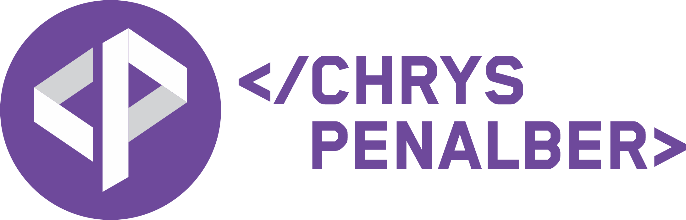
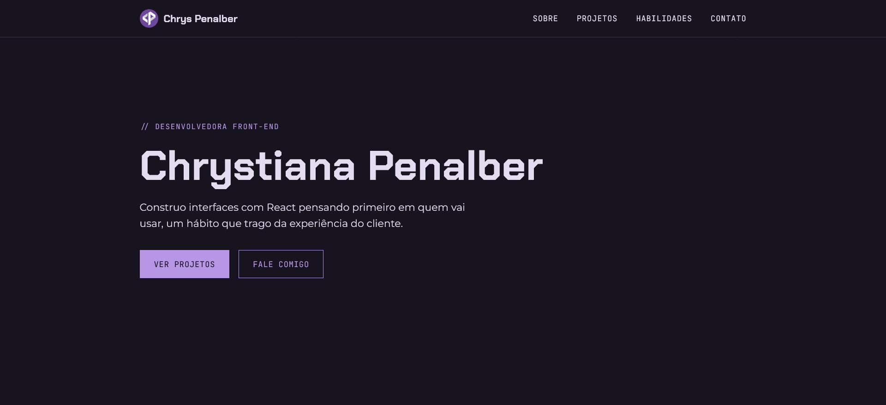

<p align="center">
  
</p>

[Versão em Português](#portugues) | [English Version](#english)

---

<a id="portugues"></a>

# Portfólio | Chrystiana Penalber

Este portfólio, desenvolvido em React, é o projeto final do curso de Engenheiro Front-End da EBAC. O objetivo era aplicar componentização, estilização modular e deploy. O site reúne uma apresentação, os projetos que fiz ao longo do curso, as tecnologias que uso e um formulário de contato.

**Acesse:** https://chryspenalber.vercel.app



---

## Tecnologias

- **React**, para montar a interface em componentes e controlar o menu mobile e o formulário com `useState`
- **Vite**, para criar o projeto e rodar o servidor de desenvolvimento
- **CSS Modules**, para a estilização, com os estilos de cada componente no próprio arquivo
- **Formspree**, para receber as mensagens do formulário de contato
- **ESLint** e **Prettier**, para manter o código padronizado
- **Vercel**, para o deploy

---

## Seções

- **Início**: apresentação curta e atalhos para os projetos e o contato
- **Sobre mim**: foto, apresentação e links de contato
- **Projetos**: quatro projetos do curso, cada um com imagem, descrição, tecnologias e links para o código e a página publicada
- **Habilidades**: tecnologias e competências em três grupos: "Uso com segurança", "Estou aprofundando" e "Além do código"
- **Contato**: formulário e links diretos

---

## Funcionalidades

- Formulário de contato que envia as mensagens de verdade, com avisos de envio, sucesso e erro
- Menu mobile que abre e fecha com `useState`
- Layout responsivo, construído primeiro para o celular (mobile first)
- Tema escuro automático, que segue a configuração do sistema
- Navegação por teclado, com contorno visível no elemento em foco
- Prévia do link ao compartilhar no LinkedIn e no WhatsApp

---

## Projetos exibidos

Projetos feitos durante o curso, na ordem em que aprendi cada tecnologia: do primeiro layout em HTML e CSS até aplicações com React e Next.js.

| Projeto                      | Descrição                                                                                    | Tecnologias                            | Links                                                                                                                       |
| ---------------------------- | -------------------------------------------------------------------------------------------- | -------------------------------------- | --------------------------------------------------------------------------------------------------------------------------- |
| Hércules                     | Página tributo à animação da Disney, com trailer, personagens, galeria e trilha sonora       | HTML, SCSS                             | [Código](https://github.com/chryspenalber/hercules) · [Página](https://chryspenalber.github.io/hercules)                    |
| Busca de endereço com ViaCEP | Formulário que preenche o endereço automaticamente a partir do CEP digitado                  | HTML, CSS, JavaScript, API REST        | [Código](https://github.com/chryspenalber/tarefa-7-web-api) · [Página](https://chryspenalber.github.io/tarefa-7-web-api)    |
| Lista de tarefas             | Aplicação para adicionar, concluir, filtrar e remover tarefas, que ficam salvas no navegador | React, Vite, Context API, localStorage | [Código](https://github.com/chryspenalber/tarefa-16-react-avancado) · [Página](https://tarefa-16-react-avancado.vercel.app) |
| Portal de viagens            | Guia de destinos com uma página para cada lugar, geradas a partir dos mesmos dados           | Next.js, TypeScript                    | [Código](https://github.com/chryspenalber/tarefa-21-nextjs) · [Página](https://tarefa-21.vercel.app)                        |

---

## Estrutura do Projeto

```text
portfolio-chrys-penalber/
│
├── public/
│   ├── compartilhamento.png
│   └── cp-logo-fundo-claro-32x32.png
│
├── src/
│   ├── assets/
│   ├── components/
│   │   ├── ContactLinks/
│   │   ├── Footer/
│   │   ├── Header/
│   │   ├── ProjectCard/
│   │   ├── SectionTitle/
│   │   ├── SkillCard/
│   │   └── TagList/
│   ├── data/
│   │   ├── contacts.js
│   │   ├── projects.js
│   │   └── skills.js
│   ├── sections/
│   │   ├── About/
│   │   ├── Contact/
│   │   ├── Hero/
│   │   ├── Projects/
│   │   └── Skills/
│   ├── styles/
│   │   ├── global.css
│   │   └── shared.module.css
│   ├── App.jsx
│   └── main.jsx
│
└── index.html
```

Em `components` ficam as peças reutilizáveis e em `sections` os blocos da página, que aparecem uma vez só. Cada pasta tem o componente e o próprio CSS Module ao lado. O conteúdo dos projetos, das habilidades e dos contatos fica separado da interface, em `data`, e é percorrido com `.map()`.

---

## Como rodar localmente

É preciso ter o [Git](https://git-scm.com) e o [Node.js](https://nodejs.org) instalados (versão 20.19 ou 22.12 em diante).

```bash
git clone https://github.com/chryspenalber/portfolio-chrys-penalber.git
cd portfolio-chrys-penalber
npm install
npm run dev
```

Depois, abra no navegador o endereço que aparece no terminal (normalmente http://localhost:5173).

### Outros comandos

- `npm run build`: gera a versão de produção na pasta `dist`
- `npm run preview`: abre localmente a versão gerada pelo build
- `npm run lint`: verifica o código com o ESLint

---

## Aprendizados

- **Estilos compartilhados com CSS Modules.** Usei `composes` para reaproveitar o visual dos botões em links e em `<button>`. No botão do menu, uma regra às vezes valia e às vezes não: as duas classes tinham o mesmo peso, e vencia a que carregava por último. A solução foi colocar a propriedade que muda o visual num seletor mais específico.
- **Formulário que envia de verdade.** O `fetch` só cai no `catch` quando não há resposta, então foi preciso conferir `resposta.ok` para tratar os erros do servidor. Guardar o status do envio como uma palavra só (`'enviando'`, `'sucesso'`, `'erro'`) também evitou combinações impossíveis.
- **Tema escuro com variáveis CSS.** Como as variáveis de cor foram nomeadas pelo uso (fundo, texto, destaque), o tema escuro só precisou redefinir o `:root`. As cores foram escolhidas medindo o contraste com o texto.

---

## Contato

- GitHub: https://github.com/chryspenalber
- LinkedIn: https://www.linkedin.com/in/chrystiana-penalber/

---

<a id="english"></a>

# Portfolio | Chrystiana Penalber

This portfolio, built with React, is the final project of the Front-End Engineering course at EBAC. The goal was to apply componentization, modular styling and deployment. The site brings together an introduction, the projects I built during the course, the technologies I use and a contact form.

**Visit:** https://chryspenalber.vercel.app


---

## Technologies

- **React**, to build the interface with components and control the mobile menu and the form with `useState`
- **Vite**, to create the project and run the development server
- **CSS Modules**, for styling, with each component's styles in its own file
- **Formspree**, to receive the messages sent through the contact form
- **ESLint** and **Prettier**, to keep the code consistent
- **Vercel**, for deployment

---

## Sections

- **Home**: short introduction and shortcuts to the projects and the contact form
- **About me**: photo, introduction and contact links
- **Projects**: four course projects, each with an image, description, technologies and links to the code and the live page
- **Skills**: technologies and competencies in three groups: "Uso com segurança" (confident with), "Estou aprofundando" (going deeper) and "Além do código" (beyond code)
- **Contact**: form and direct links

---

## Features

- Contact form that actually sends messages, with sending, success and error notices
- Mobile menu that opens and closes with `useState`
- Responsive layout, built for mobile first
- Automatic dark theme that follows the system setting
- Keyboard navigation, with a visible outline on the focused element
- Link preview when shared on LinkedIn and WhatsApp

---

## Featured Projects

Projects built during the course, in the order I learned each technology: from the first HTML and CSS layout to applications with React and Next.js.

| Project | Description | Technologies | Links |
| --- | --- | --- | --- |
| Hércules | Tribute page to the Disney animated film, with trailer, characters, gallery and soundtrack | HTML, SCSS | [Code](https://github.com/chryspenalber/hercules) · [Page](https://chryspenalber.github.io/hercules) |
| Address lookup with ViaCEP | Form that fills in the address automatically from the Brazilian ZIP code (CEP) entered | HTML, CSS, JavaScript, REST API | [Code](https://github.com/chryspenalber/tarefa-7-web-api) · [Page](https://chryspenalber.github.io/tarefa-7-web-api) |
| To-do list | App to add, complete, filter and remove tasks, which are saved in the browser | React, Vite, Context API, localStorage | [Code](https://github.com/chryspenalber/tarefa-16-react-avancado) · [Page](https://tarefa-16-react-avancado.vercel.app) |
| Travel portal | Destination guide with a page for each place, generated from the same data | Next.js, TypeScript | [Code](https://github.com/chryspenalber/tarefa-21-nextjs) · [Page](https://tarefa-21.vercel.app) |

---

## Project Structure

```text
portfolio-chrys-penalber/
│
├── public/
│   ├── compartilhamento.png
│   └── cp-logo-fundo-claro-32x32.png
│
├── src/
│   ├── assets/
│   ├── components/
│   │   ├── ContactLinks/
│   │   ├── Footer/
│   │   ├── Header/
│   │   ├── ProjectCard/
│   │   ├── SectionTitle/
│   │   ├── SkillCard/
│   │   └── TagList/
│   ├── data/
│   │   ├── contacts.js
│   │   ├── projects.js
│   │   └── skills.js
│   ├── sections/
│   │   ├── About/
│   │   ├── Contact/
│   │   ├── Hero/
│   │   ├── Projects/
│   │   └── Skills/
│   ├── styles/
│   │   ├── global.css
│   │   └── shared.module.css
│   ├── App.jsx
│   └── main.jsx
│
└── index.html
```

`components` holds the reusable pieces and `sections` holds the page blocks, which appear only once. Each folder has the component with its own CSS Module next to it. The content of the projects, skills and contacts is kept separate from the interface, in `data`, and rendered with `.map()`.

---

## Running Locally

You need [Git](https://git-scm.com) and [Node.js](https://nodejs.org) installed (version 20.19, or 22.12 and above).

```bash
git clone https://github.com/chryspenalber/portfolio-chrys-penalber.git
cd portfolio-chrys-penalber
npm install
npm run dev
```

Then open the address shown in the terminal in your browser (usually http://localhost:5173).

### Other commands

- `npm run build`: creates the production build in the `dist` folder
- `npm run preview`: serves the production build locally
- `npm run lint`: checks the code with ESLint

---

## What I Learned

- **Shared styles with CSS Modules.** I used `composes` to reuse the button styles on both links and `<button>` elements. On the menu button, a rule sometimes applied and sometimes didn't: both classes had the same specificity, and whichever loaded last won. The fix was to move the property that changes the look into a more specific selector.
- **A form that actually sends.** `fetch` only falls into `catch` when there is no response, so I had to check `resposta.ok` to handle server errors. Storing the submission status as a single word (`'enviando'`, `'sucesso'`, `'erro'`) also avoided impossible combinations.
- **Dark theme with CSS variables.** Since the color variables were named by purpose (background, text, accent), the dark theme only needed to redefine `:root`. The colors were chosen by measuring their contrast against the text.

---

## Contact

- GitHub: https://github.com/chryspenalber
- LinkedIn: https://www.linkedin.com/in/chrystiana-penalber/